<p align="center">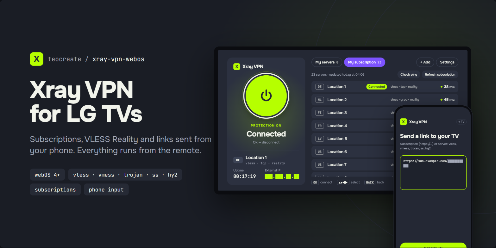</p>

# Xray VPN for webOS

A remote-friendly VPN client for **rooted LG webOS TVs**. It puts the whole TV (YouTube, Netflix, every app) behind an [Xray-core](https://github.com/XTLS/Xray-core) tunnel, with subscriptions, a server list and one-button connect, in the spirit of Happ / INCY on phones.

[Русская версия](README.ru.md)

> Not affiliated with Happ, INCY or any VPN provider. Neither of those clients is open source or available for webOS, so this is an independent implementation on top of Xray-core.

## Screenshots

The interface follows the TV language (Russian or English). Server names and IPs below are placeholders.

| | |
|---|---|
| 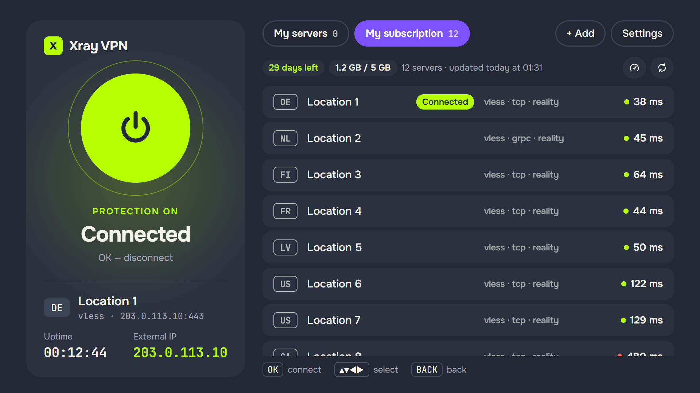 | 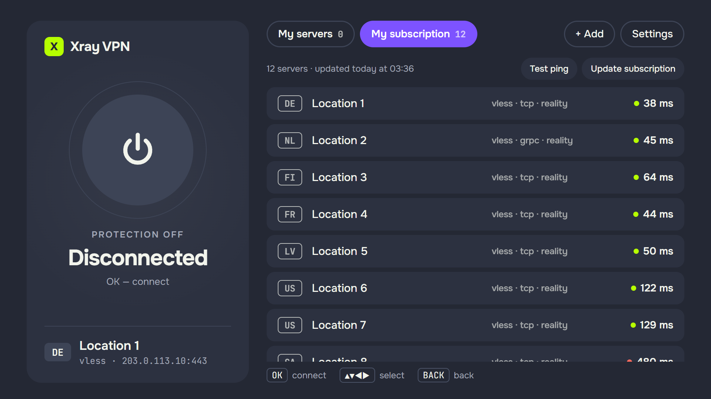 |
| **Connected.** Uptime and external IP on the left. | **Disconnected.** Pick a server and it connects at once. |
| 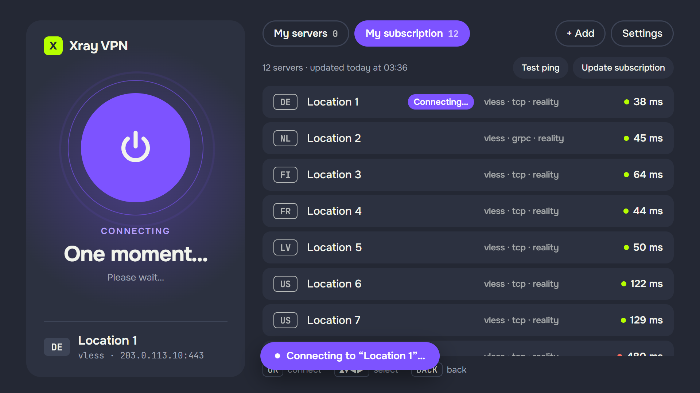 | 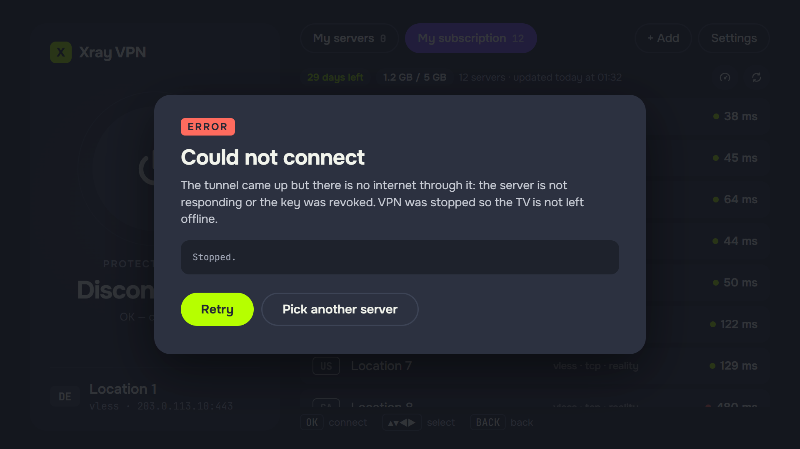 |
| **Connecting.** | **Failed.** The tunnel is torn down so the TV keeps its internet. |
| 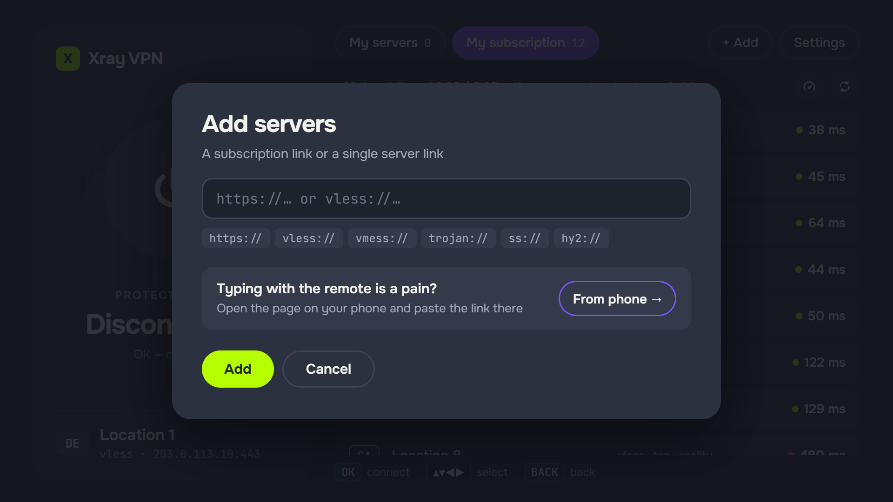 | 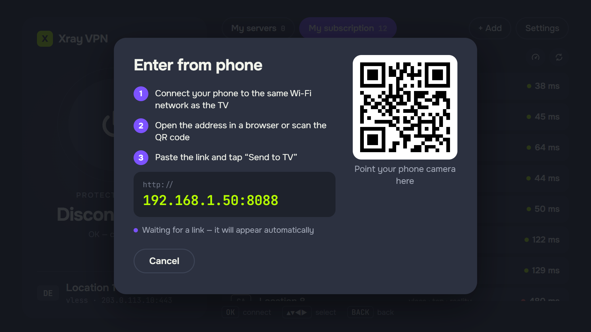 |
| **Add** a subscription or server link. | **Enter from phone:** QR code and address. |
| 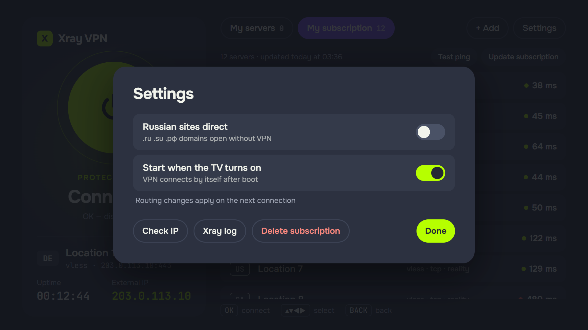 | 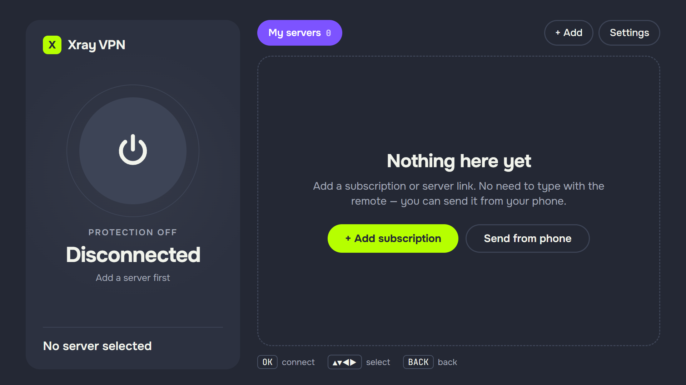 |
| **Settings.** | **First run.** |

The page the phone opens:

<p>
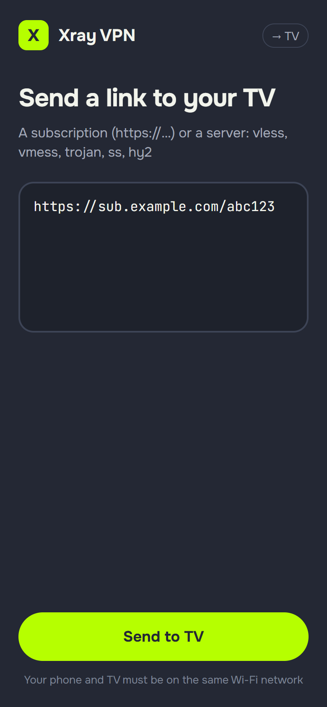
&nbsp;
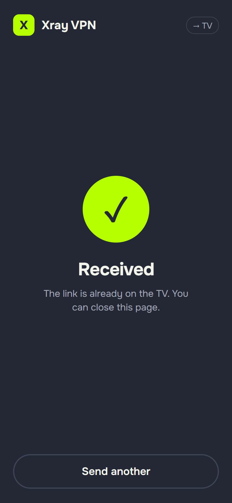
</p>

## Features

- **Full-device tunnel** through Xray's `tun` inbound; LAN and the proxy server itself stay direct.
- **Subscriptions** by URL (base64 lists, plain lists and Happ-style JSON), refresh, per-subscription tabs.
- **Protocols:** VLESS (Reality / TLS; tcp, ws, grpc, xhttp, httpupgrade), VMess, Trojan, Shadowsocks, Hysteria2.
- **Add from your phone:** the TV serves a tiny page on `http://<tv-ip>:8088`, paste a link there and it appears on the TV.
- **Magic Remote and D-pad** navigation, ping all servers, pick a server and it connects at once.
- **Bundled fonts** (Onest, JetBrains Mono) and a UI in **Russian and English**, chosen by the TV language.
- **Optional:** `.ru` / `.su` / `.рф` domains direct, autostart at TV boot, Xray log viewer.
- **Stays up in the background.** Xray runs as a root daemon, independent of the app. A watchdog restarts it after a crash or a Wi-Fi/Ethernet switch, it is protected from the OOM killer, and it **fails open**: if the tunnel carries no traffic while the local network is fine, it is stopped so the TV never loses its internet.
- Refuses links with `allowInsecure=1`.

## Requirements

- An LG webOS TV that is **rooted** with the [Homebrew Channel](https://www.webosbrew.org/) installed, and SSH access as root. Developed and tested on a webOS 4.4.3 TV (`49UK7500PLC`, `armv7l`). Other models should work; the installer picks the ARM32 or ARM64 build of Xray.
- A PC with `ssh`, `scp`, `curl` and `unzip` for the installer.
- Your own VPN subscription or server. This project provides **no** servers.

## Install

### From the Homebrew Channel (no PC needed)

1. In the Homebrew Channel open **Settings → Add repository** and enter

   ```
   https://raw.githubusercontent.com/teocreate/xray-vpn-webos/main/repo.json
   ```
2. Install **Xray VPN** from the app list and open it.
3. On the first launch the app installs its helper script and downloads Xray-core from the official GitHub release (about 12 MB), verifying its SHA-256. The TV needs internet and access to github.com. This happens once; later updates from the Homebrew Channel keep it.
4. Press **+ Add** and enter your subscription URL (or use **From phone →**).

If the first launch reports that the root service does not answer, restart the TV once and open the app again.

### From a PC

1. Download the release assets (`com.teocreate.xrayvpn_<version>_all.ipk` and the `…-unpacked.zip`) and unzip the latter.
2. Run the installer:

   ```sh
   sh scripts/install.sh <tv-ip> -k ~/.ssh/<your-root-key> --ipk com.teocreate.xrayvpn_0.3.0_all.ipk
   ```

   It downloads Xray-core, verifies its SHA-256, copies it with `vpnctl` to `/media/developer/xrayvpn/` on the TV and installs the app. Add `--dry-run` to only test the downloaded binary on the TV.
3. Open **Xray VPN** on the TV and add your subscription.

## Usage

| Action | How |
|---|---|
| Connect | Select a server in the list, it connects immediately |
| Disconnect | The big round button on the left |
| Switch server | Select another server |
| Ping | **Test ping** (turn the VPN off first, otherwise the tunnel intercepts the probes) |
| Autostart, `.ru` direct, IP check, log | **Settings** |

CLI on the TV (as root): `/media/developer/xrayvpn/vpnctl start | stop | restart | status | autostart on|off`. Logs: `xray.log`, `watch.log` in the same directory.

## Build from source

```sh
npm i -g @webos-tools/cli      # ares-package
sh scripts/release.sh           # → dist/*.ipk, dist/*-unpacked.zip, dist/SHA256SUMS
```

`TV=<tv-ip> KEY=<key> sh scripts/deploy.sh` rebuilds, reinstalls and launches the app on the TV during development (`TV`, `KEY` environment variables). Open the app with the URL hash `#debug` to expose a `window.XV` hook for remote debugging with `ares-inspect`.

## How it works

The app is a plain web app (ES5, Chromium 53 on webOS 4). It runs root commands through the Homebrew Channel's `luna://org.webosbrew.hbchannel.service/exec`, writes an Xray config, validates it with `xray run -test` and starts `vpnctl`. Subscriptions are downloaded on the TV with `curl`.

Things worth knowing, found the hard way on a 4.4 kernel:

- **`rp_filter` must be off while the tunnel is up.** The server's replies arrive on `wlan0` but the return route points at `xray-tun`; with strict reverse-path filtering the kernel silently drops them. `vpnctl` disables it and restores the original values on stop.
- Xray decides the config format by file extension (`config.new.json`, not `config.json.new`).
- `luna-send` prints nothing over SSH without a TTY (`ssh -tt`).
- IP-echo sites often return nothing through proxy servers, so "connected" is judged by `generate_204`, and the external IP is shown only when it can be fetched.

## Providers that limit devices or clients

Some providers hand out servers only to known clients or to a limited number of devices. When fetching a subscription the app identifies itself honestly (`User-Agent: XrayVPN-webOS/…`) and sends the TV's own `x-hwid` (SHA-256 of the Wi-Fi MAC), `x-device-os`, `x-ver-os` and `x-device-model`, the same device registration mechanism provider apps use. It does **not** pretend to be another app. If a provider still returns a placeholder such as "app not supported", ask them to allow the client; do not work around it.

## Security notes

- The TV runs Xray as root and the app executes shell commands as root via Homebrew Channel. Only install on a TV you control.
- Subscription URLs and servers are stored in the app's local storage on the TV and in `/media/developer/xrayvpn/config.json`; they are never sent anywhere else.
- Run `vpnctl autostart off` if you want nothing to start at boot.

## Limitations

- Tested end to end on one TV. Reboot, autostart, YouTube and speed (~20 Mbit/s on that ARM32 set) were verified; standby/wake and other models were not.
- Subscription "extra" features such as per-server routing from JSON subscriptions are ignored; only the outbound is used.
- Hysteria2 with `obfs` and Shadowsocks with plugins are not supported.

## License

MIT, see [LICENSE](LICENSE). Xray-core is MPL-2.0 and is downloaded from its official releases, not bundled.
