<p align="center">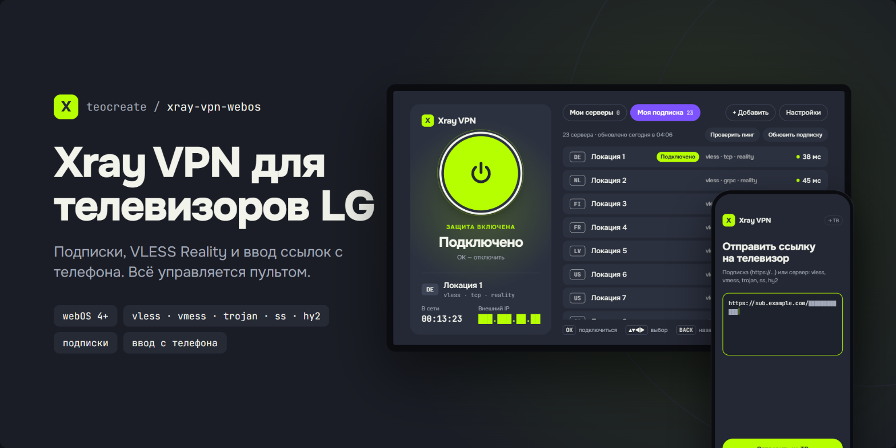</p>

# Xray VPN для webOS

VPN-клиент с управлением пультом для **LG webOS ТВ с root-доступом**. Весь трафик телевизора (YouTube, Netflix и любые приложения) идёт через туннель [Xray-core](https://github.com/XTLS/Xray-core): подписки, список серверов, подключение одной кнопкой, как Happ и INCY на телефонах.

[English version](README.md)

> Проект не связан с Happ, INCY и VPN-провайдерами. Эти клиенты закрытые и под webOS их нет, поэтому здесь независимая реализация поверх Xray-core.

## Скриншоты

Интерфейс следует языку ТВ (русский или английский). Названия серверов и IP на снимках условные.

| | |
|---|---|
| 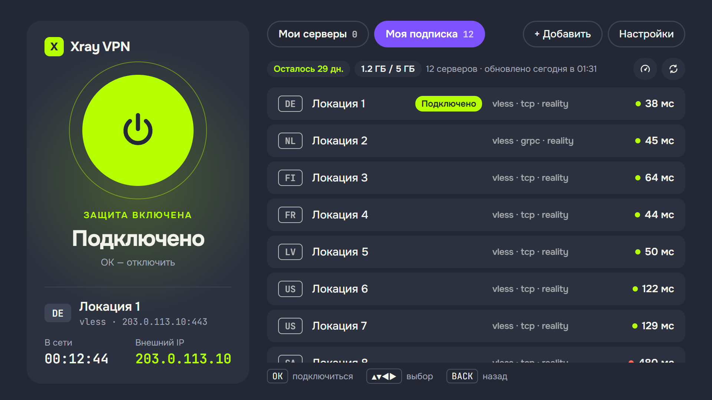 | 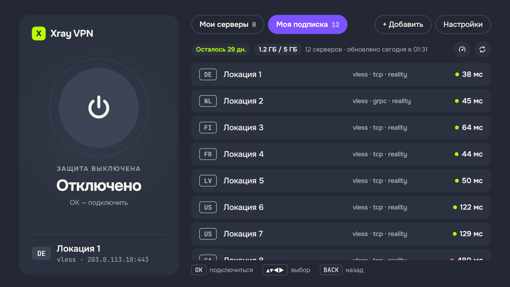 |
| **Подключено.** Время в сети и внешний IP слева. | **Отключено.** Выберите сервер, и он сразу подключится. |
| 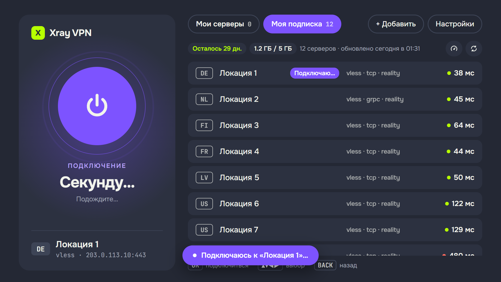 | 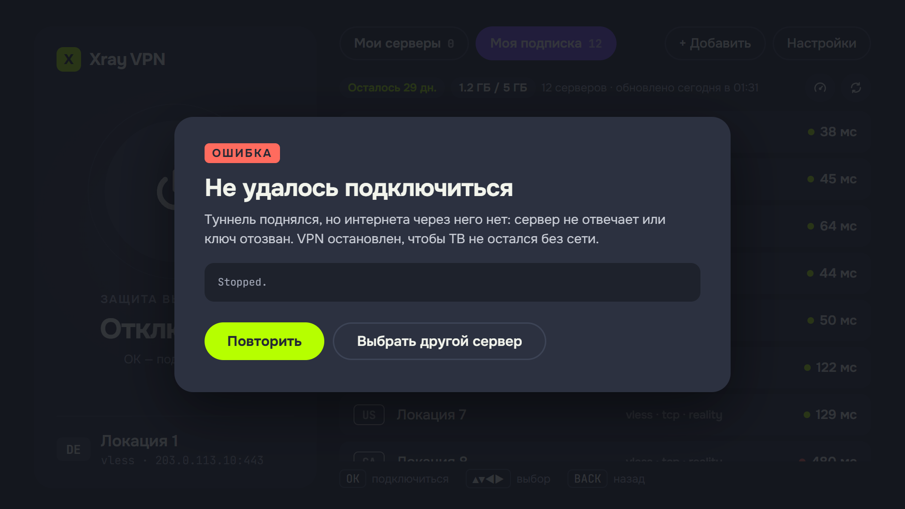 |
| **Подключение.** | **Сбой.** Туннель отключается, чтобы у ТВ остался интернет. |
| 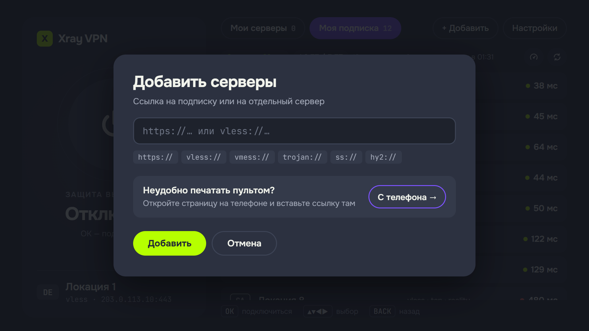 | 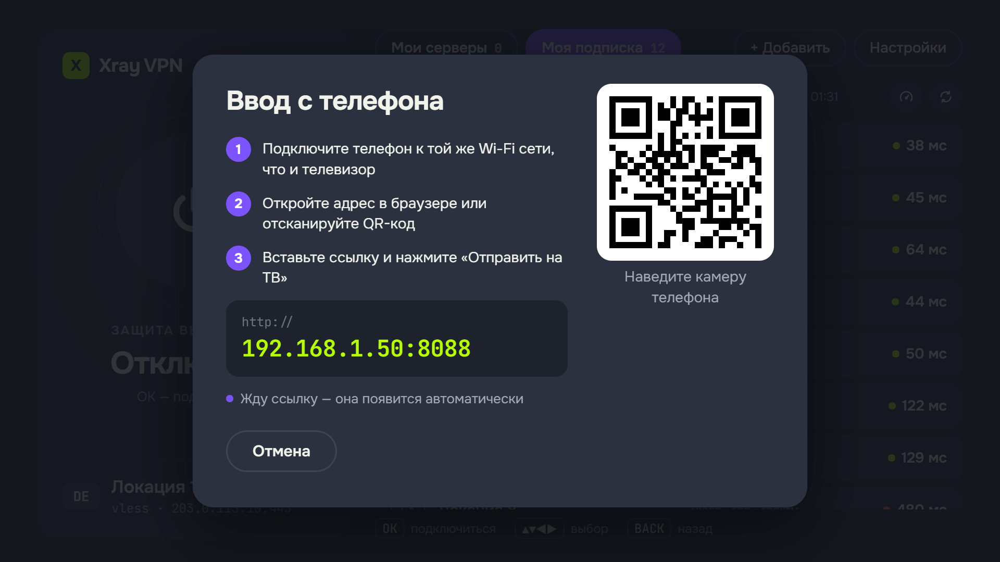 |
| **Добавление** подписки или ссылки на сервер. | **Ввод с телефона:** QR-код и адрес. |
| 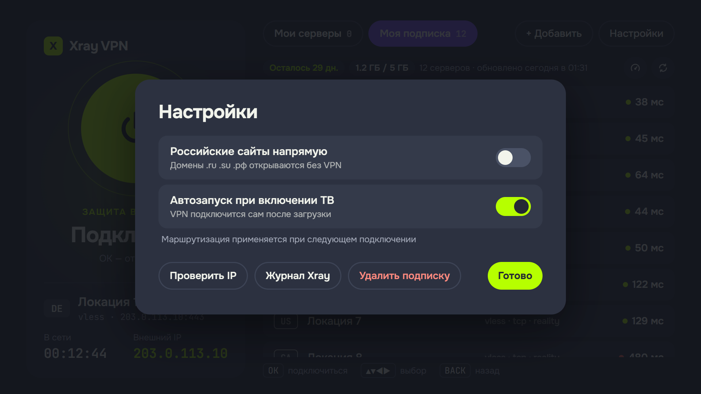 | 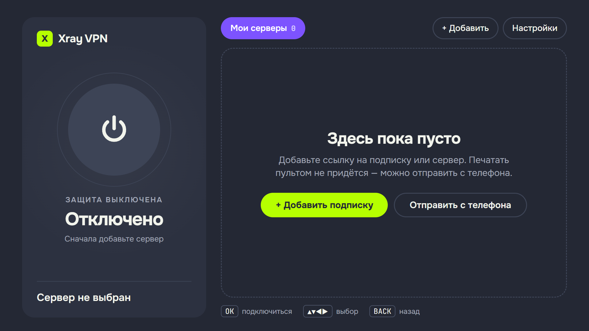 |
| **Настройки.** | **Первый запуск.** |

Страница, которую открывает телефон:

<p>
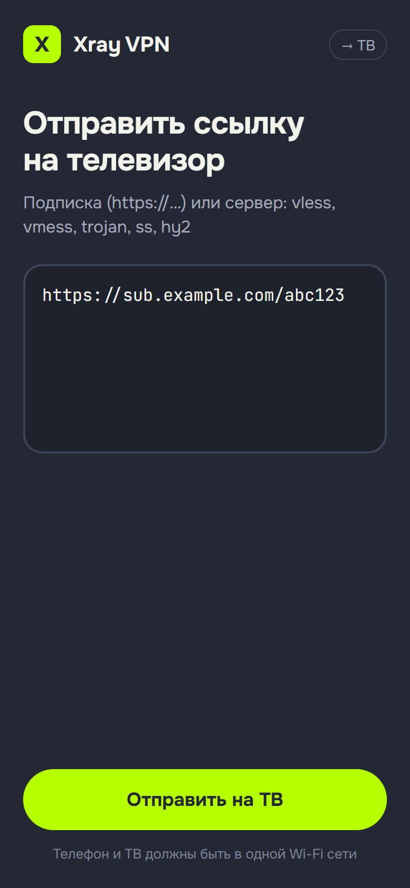
&nbsp;
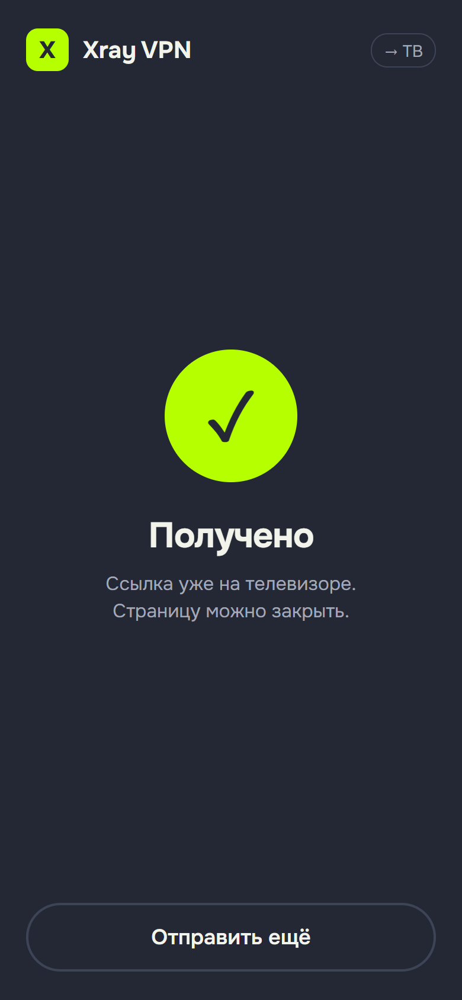
</p>

## Возможности

- **Туннель для всего ТВ** через `tun`-инбаунд Xray. Локальная сеть и сам прокси-сервер идут напрямую.
- **Подписки** по URL (base64, обычные списки и JSON в стиле Happ), обновление, вкладка на каждую подписку.
- **Протоколы:** VLESS (Reality / TLS; tcp, ws, grpc, xhttp, httpupgrade), VMess, Trojan, Shadowsocks, Hysteria2.
- **Ввод с телефона:** ТВ поднимает страницу `http://<ip-тв>:8088`, вставляете ссылку, она появляется на ТВ.
- Управление **Magic Remote и стрелками**, пинг всех серверов, выбрал сервер и он сразу подключается.
- **Встроенные шрифты** (Onest, JetBrains Mono) и интерфейс на **русском и английском**, язык берётся с ТВ.
- **Опционально:** `.ru` / `.su` / `.рф` напрямую, автозапуск при включении ТВ, просмотр лога Xray.
- **Работает в фоне.** Xray живёт отдельным root-процессом и не зависит от приложения. Watchdog перезапускает его после падения или смены Wi-Fi/кабеля, процесс защищён от OOM-убийцы и **отключается безопасно**: если туннель не пропускает трафик при исправной локальной сети, его останавливают, чтобы ТВ не остался без интернета.
- Ссылки с `allowInsecure=1` отклоняются.

## Требования

- LG webOS ТВ с **root** и установленным [Homebrew Channel](https://www.webosbrew.org/), SSH под root. Разработано и проверено на webOS 4.4.3 (`49UK7500PLC`, `armv7l`). Другие модели должны работать: установщик выбирает сборку Xray для ARM32 или ARM64.
- ПК с `ssh`, `scp`, `curl`, `unzip` для установщика.
- Своя подписка или сервер. Проект **не** предоставляет серверы.

## Установка

### Через Homebrew Channel (без ПК)

1. В Homebrew Channel откройте **Settings → Add repository** и введите

   ```
   https://raw.githubusercontent.com/teocreate/xray-vpn-webos/main/repo.json
   ```
2. Установите **Xray VPN** из списка приложений и откройте его.
3. При первом запуске приложение само установит служебный скрипт и скачает Xray-core с официального релиза на GitHub (около 12 МБ), проверив SHA-256. ТВ должен быть в интернете и открывать github.com. Это происходит один раз, обновления из Homebrew Channel его не трогают.
4. Нажмите **+ Добавить** и введите URL подписки (или используйте **С телефона →**).

Если при первом запуске появится сообщение, что сервис root не отвечает, перезагрузите ТВ и откройте приложение снова.

### С ПК

1. Скачайте файлы релиза (`com.teocreate.xrayvpn_<версия>_all.ipk` и `…-unpacked.zip`), распакуйте архив.
2. Запустите установщик:

   ```sh
   sh scripts/install.sh <ip-тв> -k ~/.ssh/<ваш-root-ключ> --ipk com.teocreate.xrayvpn_0.3.0_all.ipk
   ```

   Он скачает Xray-core, проверит SHA-256, скопирует его вместе с `vpnctl` в `/media/developer/xrayvpn/` на ТВ и установит приложение. С флагом `--dry-run` скачанный бинарник только проверяется на ТВ.
3. Откройте **Xray VPN** на ТВ и добавьте подписку.

## Использование

| Действие | Как |
|---|---|
| Подключиться | Выбрать сервер в списке, подключение начнётся сразу |
| Отключиться | Большая кнопка вверху |
| Сменить сервер | Выбрать другой сервер |
| Пинг | Иконка-спидометр над списком (сначала отключите VPN, иначе туннель перехватит пробы) |
| Автозапуск, `.ru` напрямую, проверка IP, лог | **Настройки** |

Команды на ТВ (от root): `/media/developer/xrayvpn/vpnctl start | stop | restart | status | autostart on|off`. Логи: `xray.log`, `watch.log` в той же папке.

## Сборка из исходников

```sh
npm i -g @webos-tools/cli      # ares-package
sh scripts/release.sh           # → dist/*.ipk, dist/*-unpacked.zip, dist/SHA256SUMS
```

`TV=<ip-тв> KEY=<ключ> sh scripts/deploy.sh` пересобирает, переустанавливает и запускает приложение на ТВ при разработке (переменные `TV`, `KEY`). Если открыть приложение с хэшем `#debug`, появится хук `window.XV` для удалённой отладки через `ares-inspect`.

## Как это устроено

Приложение — обычное веб-приложение (ES5, Chromium 53 на webOS 4). Root-команды выполняются через `luna://org.webosbrew.hbchannel.service/exec` сервиса Homebrew Channel: приложение пишет конфиг Xray, проверяет его `xray run -test` и запускает `vpnctl`. Подписки скачиваются на самом ТВ через `curl`.

Что выяснилось на ядре 4.4:

- **При работающем туннеле `rp_filter` должен быть выключен.** Ответы сервера приходят на `wlan0`, а обратный маршрут ведёт в `xray-tun`, и при строгой фильтрации ядро молча их отбрасывает. `vpnctl` выключает фильтр и возвращает прежние значения при остановке.
- Формат конфига Xray определяет по расширению (`config.new.json`, а не `config.json.new`).
- `luna-send` по SSH ничего не печатает без TTY (`ssh -tt`).
- Сервисы «мой IP» часто молчат через прокси, поэтому «подключено» определяется по `generate_204`, а внешний IP показывается, только если его удалось получить.

## Провайдеры с лимитом устройств или клиентов

Некоторые провайдеры отдают серверы только известным клиентам или ограниченному числу устройств. При загрузке подписки приложение честно представляется (`User-Agent: XrayVPN-webOS/…`) и отправляет данные самого ТВ: `x-hwid` (SHA-256 от MAC Wi-Fi), `x-device-os`, `x-ver-os`, `x-device-model`. Это тот же механизм регистрации устройства, что используют приложения провайдеров. Под другое приложение оно **не** маскируется. Если провайдер всё равно отдаёт заглушку вроде «приложение не поддерживается», попросите его разрешить клиент, а не обходите проверку.

## Безопасность

- Xray на ТВ работает от root, а приложение выполняет shell-команды от root через Homebrew Channel. Ставьте только на ТВ, который вы контролируете.
- URL подписок и серверы хранятся в локальном хранилище приложения на ТВ и в `/media/developer/xrayvpn/config.json`, никуда больше не отправляются.
- `vpnctl autostart off`, если не нужен запуск при загрузке.

## Ограничения

- Полностью проверено на одном ТВ: перезагрузка, автозапуск, YouTube, скорость (~20 Мбит/с на этом ARM32). Режим ожидания и другие модели не проверялись.
- Дополнительные настройки из JSON-подписок (например, маршрутизация по серверу) игнорируются, берётся только outbound.
- Hysteria2 с `obfs` и Shadowsocks с плагинами не поддерживаются.

## Лицензия

MIT, см. [LICENSE](LICENSE). Xray-core распространяется под MPL-2.0 и скачивается с официальных релизов, а не входит в состав.
